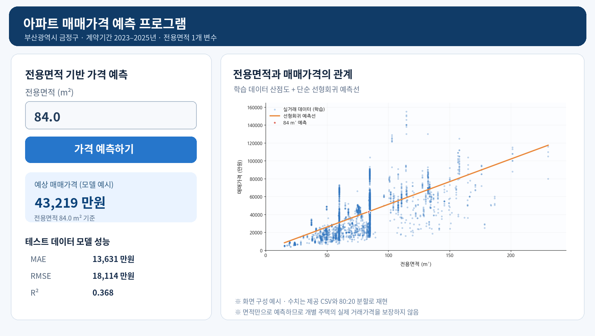

# 주택 면적 기반 아파트 매매가격 예측 프로그램
## SRS·SDS(SDD) 작성용 확정 기준 자료

> **문서 용도:** 본 문서는 완성된 SRS 또는 설계서 자체가 아니라, 학생들이 제공된 CSV와 함께 LLM에 입력하여 **SRS(요구사항 명세서)** 및 **SDS(Software Design Specification, 강의자료의 SDD: 소프트웨어 설계서)**를 작성할 때 참조하는 프로젝트 기준서입니다. 아래의 **[확정]** 항목은 교육용 프로젝트의 고정 조건이며, **[기본값]** 항목은 본 실습의 재현성과 비교 가능성을 위해 채택한 구현 기준입니다. 학생이 승인 없이 조건을 바꾸지 않도록 하십시오.
>
> **프로젝트 상태:** 교육용 실습 / 초기 버전(v1.0) / 2026-11-12 기준

## 0. LLM에 제공할 파일과 해석 원칙

- 데이터 파일: `geumjeong_apt_2023_2025_ml.csv` (**필수**).
- 본 설명 문서: `geumjeong_SRS_SDD_reference.md` (**필수**).
- GUI 참고 이미지: `gui_mockup_geumjeong_linear_regression.png` (**화면 설계 참고; 최종 사용자 인터페이스를 그대로 복제할 의무는 없음**).
- **우선순위:** ① 본 문서의 확정 사양 → ② 실제 CSV의 값·열 구조 → ③ LLM의 일반적인 제안. 충돌하면 확인 질문을 제시하며 임의로 확정하지 말 것.
- 데이터셋의 출처·지역·기간은 CSV의 2개 열만으로 검증할 수 없으며, **교수자가 제공한 데이터 생성 이력 및 정제 기록에 따른 메타데이터**임.
- 이 문서를 SRS·SDS 본문에 전부 복사하지 말고 SRS에는 **무엇(WHAT)**, SDS/SDD에는 **구성·데이터·모듈·흐름·개발 순서·검증(HOW)**를 각각 맞추어 명세할 것.

## 1. 프로젝트 목적 및 범위 [확정]

| 항목 | 확정 내용 |
|---|---|
| 프로젝트명 | 주택 면적 기반 아파트 매매가격 예측 프로그램 |
| 예측 대상 | 부산광역시 **금정구**의 **아파트 매매** 실거래가격 |
| 기준 데이터 기간 | 계약일 기준 **2023-01-01 ~ 2025-12-31** |
| 학습 데이터 취득 | 국토교통부 실거래가 공개시스템에서 **미리 내려받아 정제한 CSV를 교수가 학생에게 배포** |
| 입력 변수 X | 전용면적 `area_m2` (m²), **1개 변수만 사용** |
| 예측 대상 y | 매매가격 `price_10k_krw` (만원) |
| 핵심 동작 | 데이터 로드 → 모델 학습·평가 → GUI에서 면적 입력 → 예상 매매가격 표시·그래프 시각화 |
| 사용자 | 프로그래밍 실습 학생 및 교육용 프로그램 사용자 |
| 프로그램 유형 | 개인용 PC에서 실행하는 **Streamlit 웹 GUI** |
| 제외 범위 | 전세·월세, 단독주택, 실시간 거래 조회·API 연동·웹 크롤링, 위치/층수/건축연도 등을 입력변수로 사용하는 다변량 예측, 실제 감정평가 기능 |

**유의:** 데이터 수집은 실습 프로그램의 동작이 아님. 원본 수집/정제는 배포 전 완료되었으므로 학생 구현은 정제된 CSV의 읽기부터 시작한다.

## 2. 데이터 명세 [확정]

### 2.1 파일과 정확한 열 이름

| 열 이름 | 타입(권장) | 단위 | 역할 | 예시 |
|---|---|---|---|---|
| `area_m2` | `float` | m² | 설명 변수 X | `84.9620` |
| `price_10k_krw` | `int` 또는 수치형 | 만원 | 정답/회귀 목표 y | `45500` |

- CSV 헤더는 위 **2개 열만** 있음. 지역, 건물명, 거래연도, 거래 해제 여부 등의 열은 없음.
- **전체 데이터 행 수: 4,381건**, 헤더 제외. 열 수: **2개**.
- 제공된 데이터 범위: 면적 **15.2915–230.2700 m²**, 가격 **4,000–155,000 만원**.
- 데이터 일관성 검증용 SHA-256: `38514943f51c4ae5111caa5ac4c432f81dc8fb5d925473106c6e72bbd98d95dc`.
- CSV 인코딩: UTF-8. 데이터 값은 수치형. 로드 시 열 이름·행 수·결측·수치 변환 가능 여부를 확인한다.

### 2.2 데이터 수집/전처리 이력 (배포 전 처리됨)

| 구분 | 2023 | 2024 | 2025 | 합계 |
|---|---:|---:|---:|---:|
| 원본 거래 | 1,283 | 1,416 | 1,923 | 4,622 |
| 거래 해제 제외 | 69 | 65 | 107 | 241 |
| 최종 유효 거래 | 1,214 | 1,351 | 1,816 | **4,381** |

- 국토교통부 공개자료에서 계약일·금정구·아파트 매매로 범위를 제한해 다운로드했고, **해제 거래 241건**을 제거함.
- 필수 면적/가격 누락, 수치 형식 오류, 0 이하 값은 확인 결과 발견되지 않았음.
- 단가 극단값과 동일 상세항목 반복 거래는 *의심*으로 따로 검토했으나 임의 삭제하지 않았음. 현재 ML CSV에 **모두 포함**됨.
- 단순히 `(면적, 가격)`이 같은 행이 반복된다는 이유만으로 삭제하지 않음. 2열 파일만으로는 동일 거래 중복인지 판단할 수 없음.
- **학생 프로그램이 해제 거래를 재차 제거할 수 없음**: 해제 여부 열이 없고 이미 정제 완료됨. SRS에 '기존 ML CSV의 해제 건 제거' 기능을 요구하지 말 것.

### 2.3 초기 입력·오류 처리 기준 [기본값]

1. 필수 두 열이 없거나 CSV가 읽히지 않으면 GUI에 오류를 표시하고 예측을 중단한다.
2. `NaN`, 비수치, 무한대, 0 이하 면적·가격이 발견되면 오류로 알리며 모델 학습을 중단한다. (실습 데이터는 현재 정상.)
3. 데이터는 정렬·중복 삭제·이상치 일괄 제거하지 않고 원래 행을 유지한다.
4. 화면에 입력하는 면적은 양수 실수(소수 입력 가능)로 제한하고, 학습 범위 **15.2915–230.2700 m²** 밖이면 **외삽(extrapolation) 경고**를 보여준다. 예측 자체는 허용한다.
5. 입력 면적 0은 거부하고, 문자 등 수치가 아닌 입력은 숫자 전용 입력 위젯으로 방지한다.

## 3. 예측 방법 [확정]

### 3.1 단순 선형회귀

$$
\hat{P} = aA + b
$$

- `A`: 전용면적(m²), `P̂`: 예상 아파트 매매가격(만원)
- `a`: 전용면적 1 m² 증가할 때 추정 가격 증가량(만원/m²)
- `b`: 절편(만원)
- `a`, `b`는 **실거래 데이터로 학습하는 값**으로, 사람이 고정 입력하지 않는다.
- 방법: 최소제곱법(Ordinary Least Squares) 기반 **단순 선형회귀**.
- Python 라이브러리: `scikit-learn`, 모델 클래스: `sklearn.linear_model.LinearRegression(fit_intercept=True)`.
- **직접 임의의 단가를 곱하거나 학습 모델 없이 가격을 반환하는 방식은 요구사항을 충족하지 않음**.

**장점:** 이해와 구현이 쉽고 학습된 `a`, `b`의 의미를 해석할 수 있음.  
**한계:** 지역 내에서도 단지 위치·층수·준공연도·거래시점 등 다양한 요인이 가격을 바꾸므로 면적 하나만으로는 오차가 큼.  
**선택적 후속 확장:** `RandomForestRegressor`와 동일 분할·동일 지표로 비교할 수 있으나 **v1.0 필수 기능에 포함하지 않음**.

### 3.2 학습·테스트 분리 및 평가 [기본값]

- `train_test_split(test_size=0.20, random_state=42, shuffle=True)`을 사용.
- 행수: 학습 **3,504건(80%)**, 테스트 **877건(20%)**.
- 모델 학습은 **학습 데이터에만**, MAE/RMSE/R² 평가는 **테스트 데이터에만** 수행. 분리 전에 전체 데이터로 `fit`하지 않음.
- 사용자 입력 예측에는 **학습 데이터로 훈련된 모델**을 사용.
- 80:20 무작위 분리는 교육용 재현성 확보를 위한 기준이며, 실제 미래 거래 예측 성능을 보장하는 시간순 검증은 아님. 두 변수만 있는 CSV로는 시간순 검증 불가.
- **RMSE, MAE의 단위는 만원; R²는 단위 없음**.

| 지표 | 정의/해석 |
|---|---|
| MAE | 실제값과 예측값의 절대오차 평균. 낮을수록 좋음. |
| RMSE | 제곱오차 평균의 제곱근. 큰 오차에 더 민감하며 낮을수록 좋음. |
| R² | 결정계수. 1에 가까울수록 양호. 0 또는 음수가 될 수도 있음. |

### 3.3 기준 계산값 (검증용 예시)

이 수치는 제공된 **실제 CSV**와 위 분할 방법을 이용하여 계산한 **기준 실행 결과**다. 훈련 전 고정 상수가 아니며 실행환경/부동소수점 구현에 따라 극미한 차이는 가능하다. 기준 계산 환경: `scikit-learn 1.8.0`.

| 항목 | 기준값 |
|---|---:|
| 회귀계수 `a` | 507.545293 만원/m² |
| 절편 `b` | 585.389438 만원 |
| 입력 예시 | 84.0 m² |
| 84.0 m² 예상가격 | 43,219.194 만원 |
| 테스트 MAE | 13,631.274 만원 |
| 테스트 RMSE | 18,113.929 만원 |
| 테스트 R² | 0.368068 |

**중요:** 기준 성능이 낮다고 학생 구현이 실패한 것은 아니다. 같은 데이터와 같은 분할 및 알고리즘을 적용했는지 확인하는 **재현성 테스트**로 사용한다. 특정 R² 이상이나 MAE 이하를 임의의 필수 합격 기준으로 만들지 않는다.

## 4. GUI(화면) 요구사항 [확정]

- **GUI 프레임워크:** `Streamlit` (브라우저 기반 Python 앱), **출력 언어:** 한국어.
- **시작 방법:** 로컬 Python 환경에서 Streamlit 실행 → 브라우저 화면 표시.
- **상단:** `아파트 매매가격 예측 프로그램` 제목, `부산광역시 금정구 · 2023–2025년` 대상 정보.
- **좌측 또는 상단 입력:** `전용면적 (m²)` 숫자 입력 위젯(초기값 `84.0`), `가격 예측하기` 버튼.
- **예측 결과:** 버튼을 누른 뒤 `예상 매매가격`을 **만원**, 천 단위 쉼표와 함께 숫자로 표시. 예: `43,219 만원` (실제 기준 결과를 반올림해 보여주는 **화면 예시**, 가격 고정값 아님).
- **모델 성능:** `MAE`, `RMSE`(만원), `R²`(무차원)를 구분해서 표시; **테스트 데이터 기준**임을 명시.
- **그래프:** **학습 데이터** 전용면적·실거래가격 산점도, 학습된 선형회귀 예측선; 예측한 면적의 위치를 강조해도 좋음.
- **하단 주의 문구:** `면적만으로 추정한 교육용 예측 결과이며 실제 거래가격을 보장하지 않습니다.`
- **이상 입력:** 0 이하 입력은 예측 수행하지 않고 메시지 표시. 학습 면적 범위를 벗어난 양수 입력 시 외삽 주의 메시지 표시.
- **초기 범위에 포함하지 않는 GUI:** 지역 검색/변경, CSV 업로드, 매물 목록, 지도, 회원가입, 외부 API 호출, 예측 결과 파일 저장 기능.

### 4.1 GUI 참고 이미지 (설계 예시)

> **이미지 설명:** 실제 CSV로 계산한 회귀선·모델 성능 예시를 넣은 **정적 화면 목업**이며 작동하는 Streamlit 앱의 스크린샷은 아니다. 개발 시 레이아웃·폰트·버튼 모양은 달라도 무방하지만, 입력·결과·그래프·성능·범위 고지 내용이 누락되지 않아야 한다.

### 4.2 권장 Streamlit 구성요소 [설계 참고]

| 필요 요소 | 라이브러리/위젯 제안 |
|---|---|
| 제목·데이터 범위 안내 | `st.title` / `st.caption` |
| 수치 입력 | `st.number_input` |
| 예측 수행 | `st.button` |
| 가격·평가지표 | `st.metric` 또는 `st.write` |
| 산점도·회귀선 | `matplotlib` + `st.pyplot` |
| 경고·오류 | `st.warning` / `st.error` |

**추천 패키지:** Python 3, `pandas`, `numpy`, `scikit-learn`, `matplotlib`, `streamlit`. `scikit-learn` 1.9.1의 공식 API를 참조할 수 있으며, 정확한 설치버전 고정 대신 설치 환경에서 정상 동작하도록 구성한다.

## 5. SRS 작성을 위한 참조 요구사항 (완성 SRS가 아님)

강의자료 SRS 고정 양식: **0. 프로젝트명 / 1. 목적 / 2. 입력 / 3. 기능(FR) / 4. 출력 / 5. 제약조건 / 6. 검증 기준(AC) / 7. 미확정 사항·질문**.

| 권장 FR ID | 시험할 수 있는 기능 요구사항 |
|---|---|
| FR-01 | 실행 시 지정된 CSV에서 `area_m2`, `price_10k_krw` 열 및 유효한 수치 데이터를 읽는다. |
| FR-02 | CSV를 80% 학습/20% 테스트로 고정 시드 42를 사용해 분리한다. |
| FR-03 | 학습 데이터로 전용면적 1개 변수의 단순 선형회귀 모델을 학습한다. |
| FR-04 | 분리된 테스트 데이터로 MAE, RMSE, R²를 계산한다. |
| FR-05 | GUI에서 사용자가 m² 단위 면적을 입력하고 예측을 요청할 수 있다. |
| FR-06 | 학습된 모델로 해당 면적의 예상 가격(만원)을 반환하고 화면에 표시한다. |
| FR-07 | 학습 실거래 데이터 산점도와 선형회귀 예측선을 표시한다. |
| FR-08 | 0 이하 면적은 거부하며 학습 범위 밖 입력은 경고한다. |
| FR-09 | 파일 오류/필수 열 누락/유효하지 않은 데이터에 대해 오류를 안내하고 계산을 중단한다. |
| FR-10 | 화면에 금정구·2023–2025 기간과 면적만 이용한 교육용 예측이라는 한계를 표시한다. |

### 5.1 연결할 수 있는 인수 기준(AC) 예시

| AC ID | 대응 FR | 시험 입력·상황 | 기대 결과 |
|---|---|---|---|
| AC-01 | FR-01 | 제공 CSV 로드 | 2개 필수 열과 **4,381행** 확인 |
| AC-02 | FR-02 | `test_size=0.2`, `random_state=42` | **학습 3,504행 / 테스트 877행** |
| AC-03 | FR-03 | 모델 학습 후 계수 확인 | `a≈507.545`, `b≈585.389`(다른 데이터·분할로 학습하면 달라짐) |
| AC-04 | FR-04 | 테스트 집합에서 지표 산출 | `MAE≈13,631.3`, `RMSE≈18,113.9` 만원, `R²≈0.3681` |
| AC-05 | FR-05, 06 | GUI에 `84.0 m²` 입력 후 예측 버튼 | 예상가격 약 **43,219.2 만원** 표시 |
| AC-06 | FR-07 | 앱 시작·그래프 확인 | 학습 데이터 점과 회귀선이 눈으로 구별됨 |
| AC-07 | FR-08 | 0 입력 및 범위 외 양수 입력 | 0은 예측 불가; 범위 외 양수는 외삽 경고 |
| AC-08 | FR-09 | CSV 삭제 또는 필수 열 이름 변경 | 오류 안내 후 예측 중단(무응답·예외 화면 방치 금지) |
| AC-09 | FR-10 | 프로그램 초기 화면 확인 | 데이터 지역/기간, 교육용 한계 표시 |

**인수 판단 원칙:** AC-03~05는 올바른 파일·무작위 분할·모델 설정일 때의 **재현 기준**이다. 출력 표시 반올림 차이를 허용하고, 반드시 완전히 동일한 소수점 문자열을 요구하지 않는다.

## 6. SDS/SDD 설계 작성을 위한 결정사항 (완성 설계서가 아님)

강의자료 SDD 고정 양식: **0. 참조 SRS 버전·FR / 1. 구성 / 2. 데이터 / 3. 모듈 / 4. 흐름 / 5. 개발 순서 / 6. 검증 계획 / 7. 미확정 설계 선택사항**.

### 6.1 구현 접근 [기본값]

- **Top-down Design + Incremental Development**: 데이터 적재·분리 → 회귀 학습/평가 → 단일 면적 예측 → GUI/그래프 순서로 구현·검증. 교수자 강의자료의 방법론 A와 일치.
- 시스템 구성(논리 계층): **CSV 데이터 → 데이터 로더·검증 → 학습/평가 서비스 → 예측 서비스 → GUI 표시 및 그래프**.
- 데이터 모델: 입력 `float area_m2`, 목표 `int/float price_10k_krw`, 모델의 단일 예측 `float`(만원), 지표 `float`.
- 입력·출력 유닛: 입력 m², 가격 출력 만원. 화면 내 단위 생략 금지.
- 데이터 분할과 학습은 UI 이벤트 때마다 다시 수행하지 않고, 파일과 설정이 같은 경우 **재사용/캐시**하는 방식 권장.

### 6.2 기능 단위와 모듈 예시 [설계 기본값]

| 모듈/파일 예시 | 역할 | 주요 인터페이스 예시 |
|---|---|---|
| `app.py` | Streamlit 화면/버튼/결과·오류 표시 | 입력·예측 실행·화면 렌더 |
| `data_loader.py` | CSV 읽기 및 열·값 검증 | 데이터프레임 반환/오류 |
| `model_service.py` | 80:20 분리, 학습, 지표 계산, 단일 예측 | 모델/메트릭/예측가격 |
| `plotting.py` | 실거래 산점도, 회귀선, 강조점 생성 | 그림 객체 반환 |
| `data/geumjeong_apt_2023_2025_ml.csv` | 입력 데이터 | 읽기 전용 CSV |
| `requirements.txt` | 설치 의존성 정리 | Python 패키지 목록 |

- 파일을 1개로 구현할지 여러 파일로 분리할지는 강의 수준에 맞게 조정할 수 있지만, **기능/데이터 흐름을 SDD에 명시**해야 한다.
- SDD 단계에서는 각 모듈의 입·출력·예외 처리 책임을 명확히 할 것.

### 6.3 주요 처리 순서

1. 앱 실행 → CSV 파일 존재 및 필수 열/값 검증
2. 80:20 재현 가능한 학습/테스트 분리
3. 학습 세트로 선형회귀 모델 학습 → `a`,`b` 확보
4. 테스트 세트로 MAE·RMSE·R² 계산
5. 화면의 대상 지역/기간 및 모델 성능 표시
6. 사용자가 면적(m²)을 입력 → 버튼 클릭
7. 유효성/외삽 여부 판정 → 모델 `predict` 실행
8. 예상 가격(만원) 표시 → 실거래 산점도·회귀선/입력 면적 강조

### 6.4 단계별 검증 (교수자 권장)

- 1단계: 파일·데이터 검증 (FR-01/09)
- 2단계: 데이터 분리·학습 결과/계수 확인 (FR-02/03)
- 3단계: 테스트 RMSE/MAE/R² 기준값 재현 (FR-04)
- 4단계: 면적 하나의 예측·오류 입력 테스트 (FR-05/06/08)
- 5단계: Streamlit GUI/그래프·안내문구 통합 테스트 (FR-07/10)

## 7. 구분해야 할 개념과 금지할 추정

1. **SRS = WHAT**: 사용자가 입력/확인하는 것과 테스트 가능한 요구사항을 기술. 특정 함수 배치나 파일 이름 자체를 SRS 핵심 요구사항으로 만들지 않음.
2. **SDS/SDD = HOW**: 확정한 SRS의 FR을 모듈·데이터 흐름·개발 단계·검증 계획으로 구체화.
3. **실제 오차는 큰 편**: 테스트 R² 약 `0.368`로 면적만 사용하는 모델의 한계를 설명해야 함. 개별 매매/투자 판단용 아님.
4. **2026년 현재 가치가 아님**: 표본은 2023–2025년 계약 자료이며, 현재 시세/미래 가격을 정확하게 예측하는 제품이 아님.
5. **데이터 변경 시 재학습**: CSV가 바뀌면 계수·예측·지표가 달라지는 것이 정상임. 고정된 84 m² 가격을 코드에 쓰면 안 됨.
6. **정확도 기준의 임의 생성 금지**: MAE 임계값이나 R² 합격선을 근거 없이 '확정 요구사항'으로 만들지 말 것.
7. **고유 식별자 부재**: 2개 열로 특정 아파트 거래 조회나 거래별 추적은 불가.
8. **API/Random Forest는 확장만**: 초기 SRS/SDD에 기본 기능으로 넣지 말 것.

## 8. LLM에 함께 전달할 요청문(복사해 사용 가능)

> 제공된 `geumjeong_apt_2023_2025_ml.csv`와 `geumjeong_SRS_SDD_reference.md`를 기준으로 **SRS를 먼저** 작성해 주세요. SRS는 `0. 프로젝트명 / 1. 목적 / 2. 입력 / 3. 기능(FR-ID) / 4. 출력 / 5. 제약조건 / 6. 검증 기준(AC-ID, 연결 FR, 입력, 기대 결과) / 7. 미확정 사항` 순서로 작성합니다. CSV의 실제 열·행 구조와 참조 문서의 [확정] 사양을 우선 적용하고 다른 조건을 임의로 추가하지 마세요. 요구사항을 검사 가능한 문장으로 쓰고 FR–AC 대응 관계를 점검해 주세요. **코드는 작성하지 마세요.** SRS 검토가 끝나면 그 버전을 참조하여 `0. 참조 SRS / 1. 구성 / 2. 데이터 / 3. 모듈 / 4. 흐름 / 5. 개발 순서 / 6. 검증 계획 / 7. 미확정 설계 선택사항` 형식의 SDS(강의자료 명칭 SDD)를 작성해 주세요. GUI 참고 PNG도 가능하면 참조해 주세요. 미확정 사항은 실제로 부족한 것만 남기고 제안과 확정을 구별해 주세요.

## 9. 참고 자료 및 메타데이터 출처

- 국토교통부 실거래가 공개시스템(원자료): https://rt.molit.go.kr/pt/xls/xls.do
- scikit-learn 1.9.1 `LinearRegression` 문서: https://scikit-learn.org/stable/modules/generated/sklearn.linear_model.LinearRegression.html
- scikit-learn 회귀 평가 지표: https://scikit-learn.org/stable/api/sklearn.metrics.html
- Streamlit `st.number_input` 문서: https://docs.streamlit.io/develop/api-reference/widgets/st.number_input
- Streamlit `st.metric` 문서: https://docs.streamlit.io/develop/api-reference/data/st.metric
- 교수자 강의자료: `07-2 프로그래밍 설계방법론.pdf` (SRS 10~12쪽, SDD 13~14쪽, 실습 프롬프트 20~26쪽)
- 원자료: 교수자가 제공한 2023/2024/2025년 금정구 아파트 매매 실거래 CSV 3개; 데이터 정제 기록(`geumjeong_apt_2023_2025_audit.json`)에서 건수/지역/기간 확인.

## 10. 추가 확인사항
- CSV 파일 경로: 프로젝트 폴더의 어느 위치에 데이터를 둘 것인가?
기본은 프로젝트 폴더 아래에 data 폴더에 위치시키되 LLM이 sds 작성과정 및
구현 과정에서 최적의 위치를 찾아 배치할 것
- 실행 환경: 
실행환경은 실제 구현 단계에서 구현이 이루어지는 개발환경을 토대로 LLM이 확정할 것

